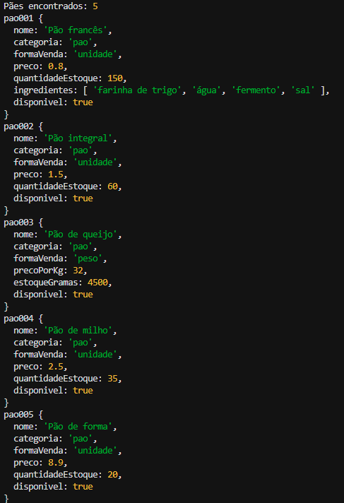
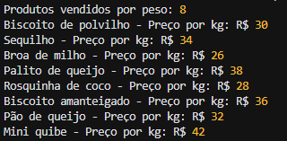
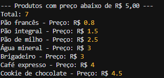
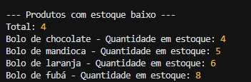
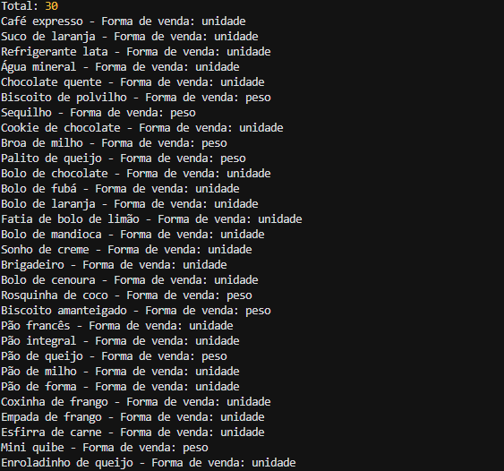

# Estudos NoSQL — Catálogo de Produtos de uma Padaria

## 1. Sobre o projeto

Este projeto foi desenvolvido para a disciplina de Banco de Dados Avançado com o objetivo de estudar o uso de bancos de dados NoSQL orientados a documentos.

O sistema representa o catálogo de uma padaria, armazenando informações sobre produtos, categorias, preços, formas de venda, estoque e disponibilidade.

O banco de dados utilizado é o **Cloud Firestore**, serviço NoSQL do Firebase.

## 2. Tecnologias utilizadas

- Node.js
- JavaScript
- Firebase Admin SDK
- Cloud Firestore

## 3. Ambiente

### 3.1. Requisitos

Para executar o projeto, é necessário ter:

- Node.js e npm instalados.
- Acesso à internet.
- Um projeto criado no Firebase Console.
- O Cloud Firestore habilitado.
- Uma chave de conta de serviço para autenticação do Firebase Admin SDK.

### 3.2. Configuração do Firebase

1. Acesse o [Firebase Console](https://console.firebase.google.com/).
2. Crie um projeto ou utilize um projeto existente.
3. Abra a opção **Firestore Database** e crie o banco de dados.
4. Nas configurações do projeto, acesse as contas de serviço e gere uma chave privada para autenticação.
5. Coloque o arquivo JSON da chave na pasta principal do projeto e renomeie-o para `serviceAccountKey.json`.

**Importante:** a chave contém credenciais privadas e não deve ser publicada nem compartilhada.

O arquivo `.gitignore` deve conter:

```gitignore
serviceAccountKey.json
node_modules/
```

### 3.3. Instalação das dependências

Na pasta principal do projeto, execute:

```bash
npm install
```

Esse comando instala as dependências declaradas no `package.json`.

### 3.4. Testar a conexão

Execute:

```bash
node scripts/testar_conexao.js
```

O script verifica se a aplicação consegue acessar a coleção `produtos` no Firestore.

### 3.5. Carregar os produtos

Execute:

```bash
node scripts/carga.js
```

O script cadastra 30 produtos na coleção `produtos`. Como os documentos utilizam identificadores definidos no código, executar novamente a carga atualiza os documentos correspondentes, em vez de criar novos IDs aleatórios.

### 3.6. Executar as consultas

Cada consulta pode ser executada separadamente:

```bash
node consultas/consucategoria_paolta1.js
node consultas/disponivel.js
node consultas/estoqueMenorQue.js
node consultas/por_peso.js
node consultas/precoMenorCinco.js
```

### 3.7. Justificativa da escolha do banco

Escolhemos o Cloud Firestore por ser um banco NoSQL orientado a documentos, com integração simples com JavaScript, hospedagem na nuvem e suporte a campos de diferentes tipos, incluindo arrays. Essas características facilitam o armazenamento e a consulta dos produtos sem a necessidade de administrar um servidor de banco de dados próprio.

## 4. Modelagem dos dados

### 4.1. Organização

O Cloud Firestore organiza os dados em coleções e documentos. Neste projeto, todos os produtos da padaria são armazenados na coleção `produtos`, e cada produto possui um documento com um identificador único.

Exemplo simplificado:

```text
Cloud Firestore
└── Coleção: produtos
    ├── Documento: pao001
    │   ├── nome: "Pão francês"
    │   ├── categoria: "pao"
    │   ├── formaVenda: "unidade"
    │   ├── preco: 0.80
    │   ├── quantidadeEstoque: 150
    │   ├── ingredientes: ["farinha de trigo", "água", "fermento", "sal"]
    │   └── disponivel: true
    │
    └── Documento: pao003
        ├── nome: "Pão de queijo"
        ├── categoria: "pao"
        ├── formaVenda: "peso"
        ├── precoPorKg: 32.00
        ├── estoqueGramas: 4500
        └── disponivel: true
```

### 4.2. Descrição dos campos

| Campo | Descrição |
|---|---|
| `nome` | Nome do produto |
| `categoria` | Categoria do produto |
| `formaVenda` | Indica se o produto é vendido por unidade ou por peso |
| `preco` | Preço de produtos vendidos por unidade |
| `quantidadeEstoque` | Quantidade em estoque dos produtos vendidos por unidade |
| `precoPorKg` | Preço por quilograma dos produtos vendidos por peso |
| `estoqueGramas` | Quantidade em estoque, em gramas, dos produtos vendidos por peso |
| `disponivel` | Indica se o produto está disponível para venda |
| `ingredientes` | Array opcional contendo os ingredientes do produto |

Os campos de preço e estoque variam de acordo com a forma de venda. Assim, o sistema diferencia produtos vendidos por unidade daqueles vendidos por peso.

### 4.3. Perguntas que o sistema precisa responder

**1. Quais produtos pertencem à categoria de pães?**

A consulta utiliza o campo `categoria` para localizar os documentos cujo valor é `pao`.



**2. Quais produtos são vendidos por peso?**

A consulta utiliza o campo `formaVenda` para encontrar os produtos com valor `peso`.




**3. Quais produtos têm preço inferior a R$ 5,00?**

A consulta compara o campo numérico `preco` com o valor 5. Na implementação atual, ela considera os produtos vendidos por unidade que possuem esse campo.



**4. Quais produtos vendidos por unidade têm estoque igual ou inferior a 10?**

A consulta utiliza o campo `quantidadeEstoque` para identificar produtos com estoque baixo. Produtos vendidos por peso utilizam o campo `estoqueGramas` e não entram nessa consulta.



**5. Quais produtos estão disponíveis para venda?**

A consulta utiliza o campo booleano `disponivel` para localizar os produtos cujo valor é `true`.



**Recurso do modelo de documentos: array**

O Firestore permite armazenar arrays diretamente nos documentos. No projeto, o produto pao001 possui um campo ingredientes, que armazena uma lista com os ingredientes do produto. Isso evita a necessidade de criar uma coleção separada apenas para essa lista.

### 4.4. Como a modelagem facilita as consultas

Os campos de categoria, forma de venda, preço, estoque e disponibilidade são armazenados diretamente em cada documento. Isso permite realizar filtros sem precisar relacionar várias tabelas, como seria comum em um banco de dados relacional.

O uso de campos numéricos permite comparações de preço e estoque, enquanto o campo booleano simplifica a consulta de disponibilidade.

O array `ingredientes` demonstra que o Firestore permite armazenar listas diretamente em um documento, sem exigir uma tabela separada para cada ingrediente.

## 5. Segurança

O arquivo `serviceAccountKey.json` contém credenciais privadas e deve permanecer fora do repositório. Ele é listado no `.gitignore`, junto com a pasta `node_modules`.

Em ambientes compartilhados ou de produção, recomenda-se utilizar autenticação gerenciada e conceder apenas as permissões necessárias.

## 6.Conclusão: qual modelo é melhor para este caso?
Os bancos de dados relacional e orientado a documentos possuem características diferentes, e a escolha depende das necessidades do sistema. Neste projeto, o Cloud Firestore foi utilizado para armazenar o catálogo de produtos de uma padaria. Seu modelo de documentos permite guardar informações relacionadas em um único documento, como o nome, a categoria, o preço, o estoque e uma lista de ingredientes. Essa estrutura facilita a representação dos produtos e oferece flexibilidade para incluir novos campos conforme a necessidade.

Por outro lado, um banco de dados relacional, como o PostgreSQL, organiza os dados em tabelas relacionadas e utiliza chaves primárias e estrangeiras para manter a integridade dos relacionamentos. Essa característica é útil para um sistema de padaria que precise controlar produtos, categorias, estoque e outras informações de forma consistente. Além disso, o SQL oferece recursos para consultas complexas e operações que envolvem várias tabelas.

Para o catálogo simples desenvolvido neste trabalho, o Firestore é uma opção adequada pela flexibilidade de seu modelo e pela facilidade de armazenar listas diretamente nos documentos. Entretanto, se o sistema evoluísse para controlar operações de estoque, vendas e movimentações que exigem relacionamentos e regras de integridade mais rigorosas, um banco relacional poderia ser mais apropriado. Portanto, não existe um modelo universalmente melhor: a escolha deve considerar os requisitos, a complexidade e a evolução esperada da aplicação.

## 7. Autores
 Eduarda Pilon Guarino e Thiago Henrique Pietrobon
